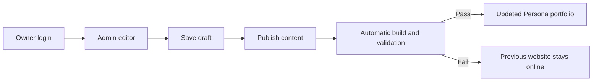

# Persona Portfolio - Long-Term Development Plan

Approved for implementation on 2026-10-19. Project root: `D:\Job Related\Portfolio\Portfolio Persona`.

## Goal and delivery
Build a recruiter-focused frontend / creative developer portfolio led by Persona 3 Reload. Pair expressive menus and motion with readable case studies, shareable URLs, and quick contact/résumé access. First delivery is local with a deployment guide. Use three clearly labeled editable examples, original artwork, optional original interface sounds (silent by default), and local content files without a database or subscription.

## Reference investigation
The 167-second 30fps Pause Menu recording and 90-second 60fps personal recording are the visual references. The installed game contains packaged resources and a native executable. REA's Windows-resource inspection is recorded as `ev_1ee6d50814b6fd6a11930c46298e9d903aac5289d5728687908e88aafbaba786`; internal UI code and exact easing curves have NOT been recovered.

Keep a ledger of navigation states, selected/unselected treatments, confirm/back behavior, tabs, lists, dialogs, layout proportions, type, palette, layering and control hints. Record timestamps, frame counts, direction, staggering and uncertainty. Mark conclusions observed, inferred, or proposed. Inspect relevant game resources only where supported; exhaustive native decompilation is not a build prerequisite.

## Architecture decisions
- Astro 7, TypeScript, scoped/native CSS and small browser scripts; static output. Markdown content collections provide validated project content.
- Astro ClientRouter provides navigation transitions. Normal links, direct loading, refresh and browser history remain functional. Reinitialize behavior through documented lifecycle events and restore appropriate focus.
- Routes: `/`, `/projects/`, `/projects/[slug]/`, `/about/`, `/contact/`, `/404/`.
- Profile contract: name, role, intro, biography, skills, socials, optional résumé. Project contract: slug, title, summary, role, technologies, date, thumbnail and alt, order, optional source/demo, example/draft flags, Markdown body.
- Exclude drafts. Label examples. Omit absent optional links. Fail required invalid content with actionable errors.
- Theme tokens hold colors, type, spacing, angles, layers and motion. Deep blues/cyan, white display type, dark selection strips and restrained pink accents. Original silhouette art and project imagery. One Reload-led theme; mobile stacks the layout.
- Keyboard: arrows within focused lists, Enter activates, Tab remains standard, Escape closes overlays and restores focus. Technology filters use query parameters and an explicit empty state. Case-study navigation uses anchors.
- Motion defaults: 120ms selection, 240ms panels, 360ms pages. Respect system reduced motion plus a local reduction setting. Optional audio begins only after opt-in and intentional interactions. Storage failure must not break the site.
- Essential content is readable without JavaScript. No intro gate. Projects immediately accessible.

## Dependency-ordered tasks
1. Project records and conventions.
2. Reference/state/timing ledger.
3. Static site and content validation.
Checkpoint A: coverage recorded and site builds.
4. Responsive landing menu.
5. Project selection, preview and filtering.
6. Markdown case studies.
Checkpoint B: home > projects > case study > contact works.
7. Editable profile and contact.
8. Shared motion and navigation lifecycle.
9. Optional interface sounds and preferences.
Checkpoint C: desktop/mobile visual and accessibility review.
10. Cross-browser checks, metadata, sitemap, recovery and optimization.
11. Maintenance/deployment/rollback handoff and add-project rehearsal.

Each task is a focused slice, normally no more than five source/document files. Detailed acceptance criteria, verification, dependencies and scope live in `tasks/todo.md`. Checkpoints are evidence reviews; the user's implementation request authorizes continuing through them.

## Acceptance checks
- `npm run check` and `npm run build` pass.
- Automated browser checks cover navigation/history, filters, direct routes, sound/motion settings and reduced motion in Chromium, Firefox and WebKit.
- Inspect 360px, 768px, 1440px and 200% zoom, long titles, many technologies, absent optional links, unavailable storage and no JavaScript.
- No keyboard traps, hidden focus, contrast failures or horizontal overflow. Check accessibility tree; manually confirm keyboard and report any screen-reader verification limit.
- Target mobile Lighthouse performance >=90 and accessibility >=95. Report actual measurements.
- Adding a project changes content/media only. Output is independent of installed game and original video paths.

## Defaults and risks
English initially. No invented biography, achievements, employers or real-project results. No accounts, CMS, backend, analytics, controller support or music. Public hosting/domain is a later phase. Retain original/licensed asset provenance and concise design decisions. Missing real profile data stays visibly editable; examples never pass as real work. Unobserved input behavior and animation internals remain explicit unknowns. Runtime/tool failures are reported, not converted into successful checks.

## Authorized visual revision,2026-10-19
The user requested stronger Persona resemblance with the game's actual backgrounds, animation, sounds, soundtrack and artbook material. This supersedes the original-art-only/no-music defaults for this local deliverable. Preserve the initial verified foundation in Git4ed489b. Use recovered assets and the supplied screenshots, record provenance and exact recovery limits, keep playback opt-in, and keep the project local. Apply the review-animations and improve-animations audit to keyboard frequency, shared scene continuity, pointer gating and staged entrances. Re-run affected browser and accessibility checks.

---

# Implementation Plan: Online Portfolio Administration

Date: 2026-10-19, Asia/Taipei. Status: proposed; planning only.

Project: `D:\Job Related\Portfolio\Portfolio Persona`.

The owner confirmed online editing with a private login from any device, using free plans where possible. This phase extends the completed portfolio. It proposes replacing file-based content editing with a browser editor; it does not authorize implementation, account creation, subscriptions, uploads or public deployment in this planning session.

## Outcome

Open `/admin`, sign in, add or edit content through forms, upload photos, save drafts, and publish. Published changes automatically rebuild the public portfolio. The owner can manage the existing website without editing source files or running commands for routine updates.

Keep the current Persona presentation, navigation, minimal splash, keyboard access, responsive layouts, and silent-by-default audio. Use a straightforward admin interface with clear labels and little animation.

## Current foundation

- Astro 7.4.0, TypeScript, static output and the existing browser test suite.
- Projects: validated Markdown in `src/content/projects/`, read through `src/lib/projects.ts` and rendered with Astro's Markdown renderer.
- Identity/contact: `src/data/profile.ts`. Scene, soundtrack and concept gallery: `src/data/persona.ts`.
- Page headings, menu descriptions, image captions, empty-state text and some media paths/srcsets are hardcoded in templates and browser scripts.
- No current online editor, hosted content store, remote publishing hook or configured production host.

## Recommended architecture

1. **Astro remains the public website.** Public routes stay prerendered. Visitors receive fast HTML and the existing Persona interface.
2. **Sanity Studio provides `/admin`.** Use its supported Astro integration, managed login and content APIs. Only the owner's invited account can edit. There is no portfolio visitor registration or custom password database.
3. **Sanity stores structured content and uploaded assets.** The owner works in readable forms and a rich-text editor. Use an ordinary asset browser, not the separately priced enterprise Media Library product.
4. **A typed content adapter separates the CMS from templates.** Preserve stable project IDs/slugs and shared rendering contracts so another CMS or a future redesign does not require rewriting every case study.
5. **Publishing triggers an automatic build.** Fetch fresh, published content during the build; validate it; deploy only a successful artifact. A failed CMS request, invalid document or failed build leaves the last successful website online.
6. **Hosting is selected before online activation.** It must support HTTPS, Git-connected builds, protected build hooks, atomic deployments, custom 404s and `/admin/*` rewrites. Hosting/account quotas are checked before choosing a free tier; the plan does not promise unlimited free hosting.

The official integration supports embedding Studio under `/admin`. A static deployment needs a rewrite for its internal routes so refreshing an editor URL works. See [Studio embedding](https://www.sanity.io/docs/astro/embedding-studio-in-astro).

Static pages update after a successful rebuild, rather than immediately when a draft is saved. The actual publish-to-live delay is measured on the chosen host and documented. See [static publishing and rebuild hooks](https://www.sanity.io/docs/astro/static-and-server-rendering).

## What the owner can manage

| Admin area | Editable content and actions |
|---|---|
| Projects | Create, duplicate, edit, order, feature, publish, unpublish, archive, restore and move to trash. Edit title, description, category, role, technologies, dates, URLs and example labels. |
| Case studies | Rich text, headings, lists, links, code examples, ordered image blocks, captions and alt text. Add, remove and reorder supported content blocks. |
| Photos and files | Upload, replace and reuse covers, screenshots, profile artwork, gallery images and résumé PDFs. Edit crop/focal point and captions. Show asset usage before deletion. |
| Profile and contact | Name, professional role, introduction, biography, skills, public email, professional links and résumé. |
| Home and page copy | Page titles, headings, descriptions, calls to action, menu labels/descriptions, footer, empty states, settings copy and 404 copy. |
| Concept gallery | Add, edit, hide, remove and reorder entries, with title, image, role/description, caption and attribution. |
| Scene and audio | Background image/video/poster, portrait, soundtrack list and interface-sound assignments. Upload replacements or select existing assets; maintain opt-in playback. |
| Site settings | Site title, default search/share descriptions and image, supported color presets, section visibility and explicit search-indexing preference. |

This is a structured content editor with supported design controls. New page layouts, new animation systems and arbitrary CSS/JavaScript remain development work. Navigation destinations are selected from known routes or validated external links. Required navigation and accessibility controls cannot be removed accidentally. Existing public routes remain stable; new standalone page types can be a later extension.

## Content contracts

- **Project:** stable ID; unique slug; title/summary/category/role; technologies; date; cover and alt text; ordered case-study blocks; optional repository/demo URLs; featured/order; example flag; lifecycle state. Title edits never silently change a published URL.
- **Profile singleton:** existing identity/contact fields, résumé reference and example state. Missing optional contact methods remain hidden.
- **Page-copy singletons:** grouped by home, projects, about, contact, shared shell and recovery. Editable headings use structured text, not arbitrary HTML.
- **Scene singleton:** image/video/poster/portrait references, track metadata and sound-cue map. Responsive image sources must derive from the selected asset; old hardcoded srcsets must not override a replacement photo.
- **Gallery entries:** title, description/role, ordered image reference, alt text/caption/attribution and visibility.
- **Site-settings singleton:** approved palette preset, labels, permitted navigation, optional-section visibility, search/share defaults and indexing control. Domain, credentials and provider configuration stay in deployment settings.
- **Assets:** managed reference, type, dimensions where relevant, alt text/caption/credit and usage references. Alt text belongs to each image usage when its meaning changes between contexts.

Studio field validation is not the only validation layer. Validate CMS responses at the website boundary as well, since direct API writes can bypass editor form rules. Disallow executable markup, unsafe URL schemes and untrusted image hosts.

## Editing, publishing and deletion

1. Create or open an item; changes save as a draft. Editing a published project does not replace its live version until Publish is used.
2. Validate required fields and review rich text/image previews in the editor. Version one also provides View live for the published page.
3. Publish content. The CMS confirms the content change; a clear notice explains that website deployment is a separate automatic step.
4. Open the hosting build-status link if needed. Do not show a fake “live” confirmation before deployment succeeds. A failed build has a documented retry path that does not require changing code.
5. Unpublish/archive/trash removes the item from the next successful public build. Removing the last project produces a useful empty state and clears featured references.
6. Trash is recoverable and does not automatically purge. Permanent content/asset deletion is a separate, clearly confirmed action after checking references and taking a backup.

Do not remove asset files while the current live deployment still references them. Keep a grace period through successful publication and rollback retention. Slug changes require an explicit action and a tested redirect; permanent removal should lead to a useful 404 and remove the item from the sitemap.

## Free-tier and access assumptions

As checked on 2026-10-19, Sanity lists a Free plan with public datasets, administrator/viewer roles and limited draft-change history; private datasets and additional roles are on paid plans. This plan starts with one owner account and content intended for a public portfolio. See [current pricing and limits](https://www.sanity.io/pricing).

The private login protects editing access. Uploaded portfolio media should be treated as public URLs; confidential documents do not belong in this media workflow. Verify that anonymous requests cannot read drafts or mutate content. No read/write secrets or build-hook URLs may appear in public bundles. Limit credentialed CORS origins to controlled development/production domains.

The owner controls the CMS, source repository and hosting accounts. No paid upgrade is enabled automatically. Review quotas and provider requirements before connecting services. Additional collaborators or stronger data privacy require a fresh plan/cost decision.

## Migration and recovery

- Snapshot the existing site and export its content inventory before migration. Preserve all three example projects and their honest example notices.
- Import Markdown into the structured editor while checking headings, lists, code, links, anchors and image captions. Preserve project slugs and internal links.
- Import or retain approved existing media references with provenance. No re-extraction from the game is needed. Site operation remains independent of local game paths.
- During migration, use an explicit local/CMS source switch on a test build. At cutover, the CMS becomes authoritative. A CMS failure must fail the build rather than silently publishing old sample content.
- Back up content and assets outside the CMS before migration and destructive/bulk operations. Establish a weekly export/retention process within the chosen free storage limits, retaining at least four weekly snapshots. Use private owner-controlled storage and verify a restore into a separate test environment.
- Retain Git for source/schema changes and a known-good deployment for website rollback. Reverting a deployment and restoring content are separate operations; document both.

## Ordered implementation phases

Twenty focused tasks and their acceptance criteria are recorded as CMS-01 through CMS-16 plus CMS-08a, CMS-08b, CMS-10a and CMS-11a in `tasks/todo.md`.

1. **CMS-01–03: Prove the foundation.** Content inventory, compatibility/private login, and one complete editable project path.
2. **CMS-04–06: Complete project management.** Covers, case-study media/blocks, ordering and recoverable lifecycle actions.
3. **CMS-07–09, including CMS-08a/b: Manage the rest of the content.** Profile/contact/résumé, shared page copy/navigation and concept gallery.
4. **CMS-10–12, including CMS-10a/11a: Complete settings and migrate.** Scene/audio, theme/site controls, complete import and content-source cutover.
5. **CMS-13–15: Operate online safely.** Automatic publication, access/failure verification and restore rehearsal.
6. **CMS-16: Owner handoff.** Mobile admin exercise, final browser/performance checks and an illustrated maintenance guide.

Every task is S/M and normally touches no more than five source/document files, excluding lockfile churn/generated artifacts. If a slice expands, divide it before implementation. Checkpoints after each group require evidence review with the owner before proceeding. No feature is marked complete merely because its editor form exists: its saved content must render correctly on the public website.

## Final acceptance

- From an authenticated desktop or phone browser, the owner can create a project, upload photos, write its case study, publish it and see it online without editing code.
- The owner can update every listed content area, replace images across all responsive sizes, change résumé/contact details, reorder items, remove content and restore a trashed project.
- Anonymous visitors cannot edit content or read drafts. Public rendering accepts only validated published content. No private credentials or draft payloads are in static artifacts.
- Save-draft changes do not leak into the public site. Publishing triggers a build; failed builds preserve the previous deployment. Unpublish/delete and repeated events behave correctly.
- Direct `/admin` and nested editor refreshes work. Admin routing is isolated from the public Astro navigation/splash; logging out revokes editing access. The public site works without JavaScript.
- `npm run check`, `npm run build` and relevant regression tests pass. Test Chromium, Firefox and WebKit; 360/768/1440px and 200% text enlargement; keyboard operation; long/empty content; failed uploads; expired sessions; CMS/build failures; blocked local storage and reduced motion.
- Preserve current public-site performance goals: mobile Lighthouse performance at least 90 and accessibility at least 95. Admin dependencies do not load on public pages.
- Backups include assets as well as documents; restoring a deleted project and its photos into a separate test environment succeeds.

## Risks and mitigations

| Risk | Impact | Mitigation |
|---|---|---|
| Astro 7/integration compatibility or admin routing | High | Prove login, nested refresh and public bundle separation in CMS-02 before broad migration. Pin compatible versions. |
| Accidental removal or a broken public layout | High | Draft/publish workflow, recoverable trash, required fields, supported blocks, boundary validation and tested backups. |
| Markdown conversion loses formatting or anchors | Medium | Compare every existing project; preserve stable slugs/heading IDs and verify direct links before cutover. |
| A replaced photo still uses old srcsets | Medium | Generate every responsive URL from the active media reference and verify all breakpoints. |
| Publish succeeds but deployment fails or races | High | Separate content/live status; serialize/coalesce builds as supported by the host; retain last good artifact; verify the latest published state. |
| Free limits/history are insufficient | Medium | Track usage, use external exports and evaluate costs before any upgrade. |
| Admin scripts/theme interfere with public motion | Medium | Standalone admin layout, ordinary entry navigation and independent styling; preserve public route tests. |
| Provider dependency or a future redesign | Medium | Typed DTOs, portable exports, schema migrations and a documented exit path. |

## Later extensions

Authenticated full-page draft previews and click-to-edit visual editing can follow after the core editor. They require a server-rendered preview route, an appropriate Astro hosting adapter and secure draft access; they are not secretly added to the static first version. Other later options: scheduled publication, collaborator roles, extra page layouts and localization. See [preview rendering requirements](https://www.sanity.io/docs/astro/static-and-server-rendering).

## Decisions needed before online activation

- Owner-controlled Sanity account/project, private source repository and hosting account; owner completes sign-in/terms when required.
- The real domain, hosting provider and its verified current free-tier limits/build-hook capability.
- Owner-controlled backup destination and retention within its storage quota.
- Review/approval of this proposed plan before implementation; public launch remains a separate explicit action.

No application code, CMS account or live website was changed during planning.

